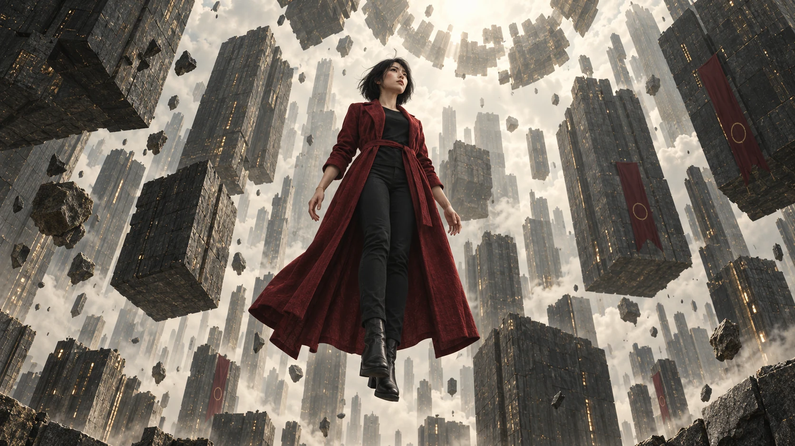

<p align="center"></p>

# 飞升 / Ascension

**一张 4060 Ti，0 成本，4 天生成。让想象力飞升。**

一部视觉音乐概念 MV，也是一份可以拆开学习、继续创作的制作档案。章浩提出创作方向与修改意见，AI 完成分镜、工作流配置、素材生成、筛选、剪辑和验证。我们公开的不只是成片，还有从第一句提示词到最后一个切点的过程。

**[观看影片与设定集](https://art.zzh.app) · [下载图稿与制作资料](https://github.com/ZetaZeroHub/ascension/releases/tag/v1.0.0) · [English](README.en.md)**

> “0 成本”指本地视频生成没有额外 API 费用，不包含已有电脑、AI 订阅及电费；部分分镜参考图使用 AI 图像服务生成。四天为作者提供的制作工期：概念与分镜 1 天、素材生成 2 天、自动化剪辑 1 天，不是可向所有机器保证的耗时。

## 先看什么

| 你想做的事 | 入口 |
|---|---|
| 看完整 MV、人物设定和所有设计迭代 | [art.zzh.app](https://art.zzh.app) |
| 用自己的机器复现一个镜头 | [ComfyUI 安装与复现](docs/REPRODUCE.md) |
| 找工作流、输入图、模型 | [工作流目录](site/archive/ComfyUI留存-v11/工作流) · [API 目录](site/archive/ComfyUI留存-v11/API) · [模型清单](site/archive/ComfyUI留存-v11/模型清单.json) |
| 学提示词、分镜和节拍方法 | [技能与安装](docs/SKILLS.md) · [制作过程](docs/PROCESS.md) |
| 学习剪辑与重新生成 | [剪辑时间线与素材替换](docs/EDITING.md) |

## 这个项目保留了什么

- **26 个可浏览页面**：红绸概念、故事与人物定型、调色对照、独立分镜、舞蹈扩展、四种材质实验、制作记录。
- **68 份原生节点工作流 + 68 份 API 配置**：保留种子、采样步数、提示词、参考帧和连接关系。
- **75 张原始 ComfyUI 输入图、61 份历史记录、9 项模型记录**：文件名、用途、大小与校验范围可查。历史第 76 项为运动参考视频，仅留存在作者本机。
- **可编辑剪辑资料**：时间线、MCP 编辑清单、切点调整与静态抽帧对照；原始/衍生视频和独立音轨不上传。
- **历史生产脚本与新的便携工具**：前者记录当时怎么做，后者帮助下载素材、安装工作流和重定位剪辑路径。

网站仅保留静态图稿和一条完整 MV，模型权重及所有历史视频/音频素材不上传。默认下载 `ascension-website-media.zip`；需要在 ComfyUI 复现时，再选下 `ascension-comfy-input-images.zip`，其中 75 张原始输入图位于 `reproduction/inputs/`，不会部署到网站。两个包用途不同，无需为浏览网站下载原始输入图。

## 普通显卡怎样跑大模型

本项目实测配置为 **RTX 4060 Ti 8GB / 32GB RAM / NVMe SSD / Windows**。这是一套跑通的配置，并非已经证明的最低配置。留存环境：ComfyUI 0.37.4、Python 3.12.9、PyTorch 2.9.1+cu130、前端 1.52.7。

MiniMax H3 FL2VA / REF2VA 使用 INT8 量化权重，Qwen3-VL 32B 编码器使用 NVFP4/AWQ。通过动态显存、NVMe 卸载、关闭 pinned memory、预留 2.5GB 显存、限制内存缓存及关闭动态预览降低运行压力；每次只生成一个镜头。

```text
--enable-dynamic-vram --fast-disk --disable-pinned-memory
--vram-headroom 2.5 --cache-ram 6 8 --preview-method none
```

| 留存档位 | 原生尺寸 | 采样 | 用途 / 已知耗时 |
|---|---|---|---|
| v11 风格试片 | 640×384，73 帧，24fps | Turbo 8 步 | 单段约 3.04 秒；实测 2.50–3.58 分钟，中位数 2.69 分钟 |
| v10 高清镜头 | 1280×736 | 25 步 | 裁切输出 1280×720；不能套用 v11 的耗时 |
| 早期红绸试作 | 704×384 | 20 步 | 当轮单段约 6.47–7.42 分钟；不是最终所有镜头的统计 |

INT8 权重仍需要较大磁盘和系统内存空间。9 项记录合计约 59.4GiB；4x-UltraSharp 仅用于超分对照，最终选择未采用全片 AI 超分。已有大权重只记录头部哈希与文件大小，不冒充全文件 SHA-256。两个风格 LoRA 有固定 revision 与全文件 SHA-256。

## 从故事到成片

主角是一名红衣信使。静止的城市、被封存的光种、追逐、断桥和主动跃下，组成一次英雄之旅。红衣、短发、金色腕线与光种维持跨镜头识别，超现实建筑与重力反转承担情绪变化。

1. **概念设计**：用对话确定主角、动机、选择和结局，先让每个镜头有因果。
2. **分镜设计**：提示词明确人物、动作、机位、材质、光线与前后关系；比较多轮图稿，逐渐收敛。
3. **素材生成**：将定稿参考图与动作提示词送入 ComfyUI，逐段生成；保留失败和修正，不把队列完成等同于画面合格。
4. **自动剪辑**：使用社区剪映 MCP 创建工程、导入素材和调整时间线，结合音乐瞬态、节拍、运动方向与情绪安排切点。
5. **验证**：复核切点前后画面、音频偏移、时长与帧数，并在实际剪映中查看工程和导出结果。

“我只写提示词”描述人的操作方式。AI 实际综合使用 **MCP、脚本、API 与 Computer Use**，不是每个动作都用鼠标完成。剪映 MCP 是社区项目，不是剪映官方产品。

## 运行网站

无需 Node、Vue、React 或构建步骤，Python 标准库即可预览：

```sh
git clone https://github.com/ZetaZeroHub/ascension.git
cd ascension
python scripts/fetch_media.py
python -m http.server 8080 --directory site --bind 127.0.0.1
```

打开 `http://127.0.0.1:8080`。默认只下载轻量网站媒体包，体积见 Release 清单。原始输入图需显式添加 `--inputs`。也可以先只克隆代码阅读文档。网站用原生 HTML/CSS/JS，支持中英文、原生视频播放、懒加载分镜与减少动态效果偏好。

```text
site/                 网站、压缩图稿、公开工作流和剪辑档案
reproduction/inputs/  可选原始输入图，不部署到网站
production-scripts/   脱敏后的历史生产代码，需按自己的路径适配
scripts/              便携安装、下载、重定位和发布检查
skills/               本项目编写的可安装创作技能
docs/                 复现、模型、技能、剪辑与发布说明
deploy/               不含凭据的 Nginx 模板
```

## 版本与边界

网站播放的是作者最后提供的普通导出版本：**1280×720 / 24fps / 约 93.762 秒**。历史精修母版为约 **95.083 秒**。此前零音频偏移、41 段/40 切点和素材包校验对应历史母版，不能直接视为对所有后续导出的证明。

67 份节点工作流使用留存后端支持的原生节点；1 份早期 Image Studio 工作流依赖历史自定义节点，保留作研究，未打包第三方节点源码。新机器上的实际速度、节点兼容性和生成画面仍需自己验证。脱敏会改动历史路径、媒体元数据及文件哈希，发布包校验以本仓库的新清单为准。

## 开源与致谢

本项目原创代码采用 [MIT](LICENSE)；原创音乐、图片与视频按作者可授权的权利范围使用 [CC BY 4.0](LICENSE-ASSETS.md)。模型权重、第三方插件、技能与商标分别遵循原作者条款，**不随本仓库重新授权**。详见 [第三方来源](THIRD_PARTY_NOTICES.md)。

感谢 [ComfyUI](https://comfy.org/)、[MiniMax](https://www.minimax.io/)、[OpenAI Codex](https://openai.com/codex/)、[剪映](https://www.capcut.cn/)、[Xanthus-Sanslab/jianying-ai-mcp](https://github.com/Xanthus-Sanslab/jianying-ai-mcp)、[Remotion](https://www.remotion.dev/) 与各 LoRA 作者。

如果它帮你跑通了一个镜头，欢迎带着配置、实际耗时和作品来开 Issue。**从这份工程继续，而不是从零重来。**

### 在线播放 / Online playback

官网的成片区域使用哔哩哔哩嵌入播放器：[BV17zpn62ESB](https://www.bilibili.com/video/BV17zpn62ESB/)。页面不再请求本站的 MP4；历史下载包保持原样。移动端保留视频播放器，隐藏网易云音乐 iframe。

The website streams the finished film through Bilibili rather than loading the site-hosted MP4. Existing release archives are unchanged. The video player stays available on mobile; only the NetEase music embed is hidden.
